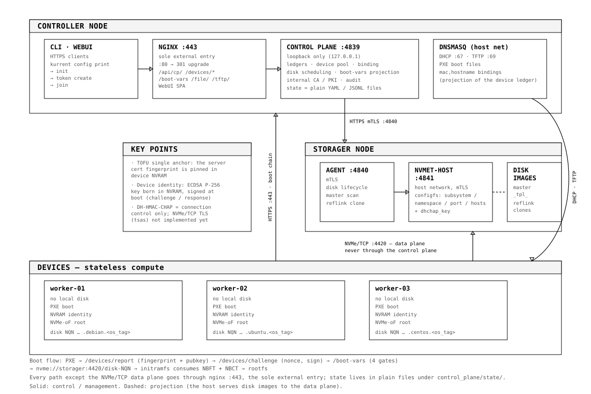

# 架构

## 控制面 / 数据面分离

系统沿一条清晰的线切分：**控制面**经 HTTPS 处理身份、调度与配置；**数据面**承载 NVMe-oF 块读写，永远不经过控制面。Worker 的盘流量在设备与 Storager 宿主之间直连（TCP `4421`，TLS 1.3），控制面故障只会影响开通流程，不会中断进行中的 I/O。

## 三个角色

### Controller（控制器）

集群大脑。容器化节点，运行：

- **控制面 HTTP 服务**（容器内 `:8080`，宿主仅 `127.0.0.1:4839`）——设备台账与设备池、设备↔Worker 绑定、Worker 生命周期编排、存储调度（系统盘创建 / 删除）、启动变量投影、审计日志
- **nginx**（`:443`，唯一对外入口）——WebUI SPA、管理面 API（`/api/cp/`）、引导链裸路径（`/devices/…`、`/boot-vars`）、iPXE 资产（`/file/`）与菜单（`/tftp/`）；`:80` 仅 301 升级
- **dnsmasq**（host 网络）——DHCP / TFTP 与引导文件分发
- **Web UI**——REST API 的一个客户端，不是独立系统；鉴权走会话 Cookie
- **CLI**（`kurrent`）——`config print` 生成声明 → `init` 收敛控制面 → `token create` 签发引导凭据 → `join` 节点接入

状态以纯文件（YAML / JSONL）持久化在 `control_plane/state/` 与 `control_plane/config/`，当前未引入数据库；声明式配置 `control_plane/kurrent.yaml` 为权威，派生物（如 `dnsmasq.conf`）由控制面启动时按它渲染。全部能力经 REST 开放——Web UI 与 CLI 都只是它的客户端。

### Storager（存储节点）

块存储。每节点运行两个组件：

- **API Agent**（`:4840`，mTLS）——盘文件生命周期（母盘扫描、reflink 克隆、删盘）与存储调度客户端，经 HTTP 驱动本机后端
- **nvmet-host**（`:4841`，host 网络宿主服务，mTLS）——把控制面指令翻译为内核 configfs 操作（subsystem / namespace / port / `allowed_hosts` 与 `dhchap_key`），并把 TLS 预共享密钥注入内核全局 `.nvme` keyring；数据面端口为 **`4421`（TLS 1.3），固件段与内核段共用**

后端以 **nvmet 为首选**；iSCSI 后端（stgt / lio）代码保留，但主分支已无存活的引导路径（历史实现见 `iscsi-classic` 分支）。后端差异封装在 Agent 内部：控制面只发 HTTP，数据面地址与 Host NQN 经启动变量下发给设备。

### Devices（算力设备）

无状态计算侧。物理设备不承载持久状态：PXE 引导时上报指纹（MAC / UUID / SMBIOS / CPU / 内存 / 网卡，共 11 字段）并入**设备池**；绑定到 Worker（计算身份）并具备系统盘后，以 NVMe-oF 为根设备启动（`nvme://<storager>:4421/<盘 NQN>?tls_psk=…`）。块读写直走数据面，不经过控制面。

## 三实体模型：设备、Worker 与系统盘

角色层对应三个实体对象：

| 实体 | 身份 | 说明 |
|---|---|---|
| **设备（Device）** | MAC（唯一） | 物理机器，台账条目；绑定的权威侧 |
| **Worker** | `worker_id`（即 hostname） | 计算身份；设备绑定到 Worker 后成为该 Worker 的引导节点 |
| **系统盘（System Disk）** | **NQN**（`<base>:<hostname>.<os>.<os_tag>`） | 存储卷（母盘克隆或空白盘）；每 Worker 可挂多块 |

盘标识以 **NQN 为权威**，IQN 由 NQN 派生（iSCSI 后端与安装器消费）；`os_tag` 是 12 位随机 hex，同时充当盘文件名后缀与 NQN 末段。

绑定关系权威在**设备侧**（`bound_worker_id`），Worker 侧只是投影。盘机分离：解绑或换绑时设备回池，系统盘保留在 Worker 上。

- 设备生命周期：`pooled`（池中待绑定）→ `bound` → `revoked`
- `force=true` 换绑是原子的：新绑定落盘 → 旧绑定清除 → 失败时回滚台账快照
- 一台 Worker 可挂多块系统盘（不同系统），默认启动系统可在线切换
- `readiness` = 有绑定设备 + 有系统盘（`ready` / `partial` / `idle`）

## 引导链路

1. 设备通电 → DHCP（dnsmasq）→ TFTP 下载 iPXE → iPXE 启动
2. **设备身份**：`keygen` 首次生成 ECDSA P-256 私钥（持久化在 EFI NVRAM，不出机器）→ `pubkey` → `/devices/report` 上报指纹与公钥；未知 MAC **仅在注册窗口开启且带有效公钥时**入池
3. **挑战-响应**：`/devices/challenge` 取一次性 nonce → `sign <nonce><mac>` → `/boot-vars?…&sig=`
4. **`/boot-vars` 准入**：识别命中（MAC 经设备台账反查；未传 MAC 或台账未命中时用 hostname 兜底）→ **绑定即认证**（请求 MAC 必须属于命中 Worker 的绑定设备）→ 身份验签（强制开关开启时，无密钥 / 无签名 / 验签失败一律拒绝）→ 密钥库有条目才注入凭据（**nvmet 节点上，建系统盘时即自动签发**）；全部通过才投影 root-path、NQN 与密钥
5. 池中未绑定设备：reboot 循环等待绑定
6. **连接数据面**：root-path 为 `nvme://<storager>:4421/<盘 NQN>?secret=…&tls_psk=…&tls_trsvcid=4421`，以 **DH-HMAC-CHAP** 完成连接控制、以 **TLS 1.3** 完成传输加密；密钥按 Worker 跟盘、仅随本次引导会话存活，不落盘
7. **交接给 OS**：固件在 sanboot 时安装 **NBCT** 凭据表（自定义 ACPI 表，iBFT 式注册，每条记录含 traddr / trsvcid / nqn / hostnqn / secret，控制面已下发时还带 TLS PSK 与 TLS 端口）；initramfs 的 `nbft-connect` 消费 **NBFT**（网络与子系统发现）与 **NBCT**（凭据与 hostnqn 身份中继），带 PSK 时以 `--tls` 连 TLS 端口重连，并挂载根文件系统
8. 系统启动到登录提示符——**盘内不写死任何一个字节的机器身份**

> 完成度：NBCT 由固件生成（固件补丁 `0009`）；**iPXE 侧生成 NBFT 仍是待实现项**——已验证的整机链路（QEMU + nvmet 六环，含认证）用注入的 NBFT 表模拟"固件预生成"阶段。

## 安全边界

两层彼此正交的信任。

**① 管理面认证**——三种凭据串行短试、统一产出 `Identity{name, groups, method}`：

- mTLS 客户端证书（nginx 校验链后透传 DN，CN = 用户名、O = 组）
- 管理 token（Bearer，台账只存 sha256 摘要，TTL 内有效）
- 会话 Cookie（HttpOnly 签名会话，7 天滑动续期，浏览器登录态）

授权：读请求只需已认证，写请求需 `admin` 组。凭据自举：控制面启动时用内部 CA 签发 admin 证书并渲染 `admin.conf`。

**信任前提**：`X-Client-Cert-DN` 头只信 nginx 注入，因此 **443 是唯一对外入口、控制面端口只绑 `127.0.0.1`**——两者缺一即可伪造管理员身份。

**② 设备身份信任根**——引导链上的设备认证：

- 私钥在设备 NVRAM 内生成并持久化（ECDSA P-256），指纹上报不鉴权，但只喂设备池、不产生任何权限
- 挑战-响应验签（nonce 一次性、绑定 MAC）证明"这台机器确实是它"
- TOFU 单锚：服务器自签证书的指纹在首次握手时落到设备 NVRAM，其后任何校验失败即中止
- **绑定即认证**：`/boot-vars` 校验请求 MAC 是否属于命中 Worker 的绑定设备，防止其他设备冒领引导身份

**认证 ≠ 加密——两者是彼此独立的层**：DH-HMAC-CHAP 回答"谁能连"，本身不保护数据面内容。内容保护由**数据面端口上的 TLS 1.3**承担（`4421`，`tsas=tls1.3`、`treq=required`），固件段与内核段共用该口：固件自己完成 TLS 1.3 PSK 握手，内核/initramfs 随后在同一端口以 `--tls` 重连（PSK 由 NBCT 表交接）。预共享密钥是**认证密钥的纯函数**（HMAC-SHA256，域分离派生）：不新增存储字段，因此轮换或吊销认证密钥即原子地轮换/吊销 PSK。存储节点侧由控制面推送落到内核全局 `.nvme` keyring。加密是默认行为且**无明文回退**：已无第二个端口可退，故数据面端口未就绪或密钥缺失时，控制面拒绝下发引导变量（记审计），`menu.ipxe` 同样 `goto failed`，不再拼明文 URI。

## 协议演进

数据面已从 iSCSI 迁移到 **NVMe-oF（NVMe/TCP）**：固件主分支含完整补丁集（`0001`–`0010`，含 nvmetcp 驱动、TOFU 指纹、设备密钥命令、NBCT 与固件侧 TLS 1.3 PSK 客户端），整机冷启动已在多个发行版通过验收。

语义——无状态计算、盘机解耦、从 MAC 到引导的一条身份链——并不依赖具体协议：Storager 后端已由 Agent 抽象，更换传输层不触碰架构。iSCSI 在主分支已无存活的引导路径，其历史实现保留在 `iscsi-classic` 分支；NVMe/TCP TLS 的冷启动——固件段（iPXE `sanboot` 自带 TLS 1.3 PSK 握手）与内核段（`nvme connect --tls`）——均已端到端验收，尚待推进的是 NBCT 表向发行版/上游生态的对齐。
